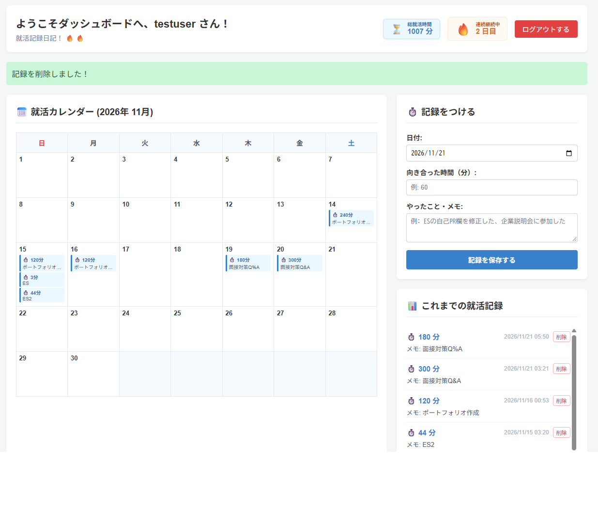
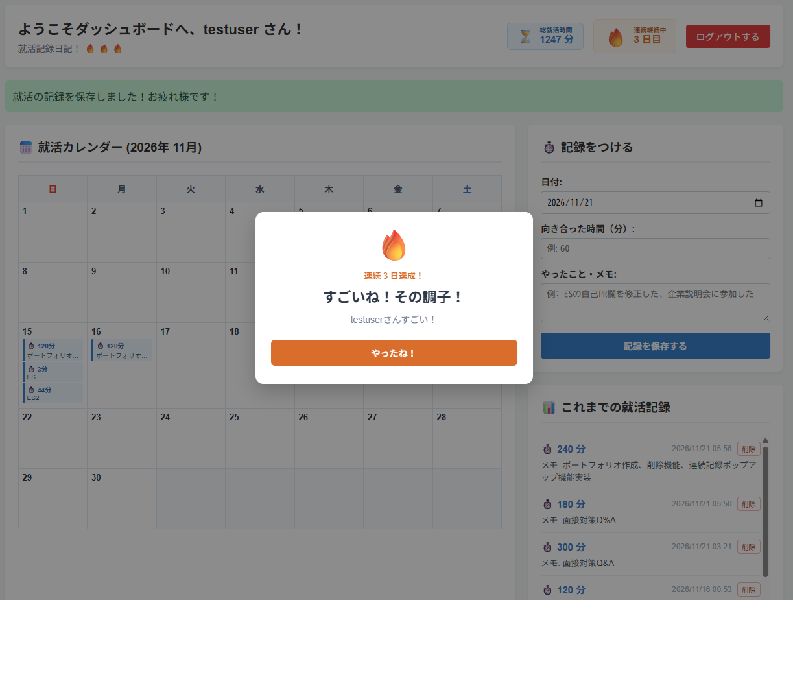

# 就活習慣化アプリ

就職活動の取り組みを毎日の習慣として定着させるためのWebアプリケーションです。日々の活動時間やメモの記録、カレンダーでの可視化、連続継続日数のカウントと達成ポップアップによって、就活の継続とモチベーション維持をサポートします。

## リンク

- **GitHubリポジトリ**：https://github.com/s-hiroto-dev/my-portfolio

## 作った背景・目的

就職活動は長期戦になりやすく、日々の小さな積み重ねが見えにくいことでモチベーションの維持が難しくなりがちです。「毎日少しでも就活に向き合う習慣をつくること」をテーマに、継続日数や累計時間が一目で分かり、達成感を得られる仕組みを目指して開発しました。

## 主な機能

- **就活記録の登録・削除**：日付・向き合った時間（分）・やったことメモを記録し、履歴一覧から削除できます。
- **就活カレンダー表示**：月ごとのカレンダー上に日々の記録を表示し、取り組みの継続状況を視覚的に振り返れます。
- **総就活時間・連続継続日数の集計**：累計の取り組み時間と、連続して取り組んでいる日数を自動で算出して表示します。
- **連続記録達成ポップアップ**：連続日数が伸びたタイミングでポップアップを表示し、ログイン中のユーザー名入りで達成をお祝いします。
- **ユーザー認証機能**：ユーザーごとのデータ管理（ログイン・ログアウト）に対応しています。

## 画面イメージ




## 使用技術

- **バックエンド / フレームワーク**：PHP / Laravel
- **フロントエンド**：Blade, HTML / CSS
- **データベース**：MySQL
- **開発環境**：Docker / Docker Compose（Laravel Sail 構成ベース）
- **バージョン管理**：Git / GitHub

## 実装で工夫したポイント

1. **連続日数計算ロジックのメソッド切り出し**
   - 連続継続日数の計算処理を専用メソッドにまとめ、記録登録の前後で一貫して判定できるようにしました。
2. **フラッシュセッションを活用した達成演出**
   - 記録保存後のリダイレクト時に一時データを渡し、連続日数が更新されたときだけポップアップが表示されるように制御しました。
3. **セキュリティ・Git管理の意識**
   - Bladeでの安全な変数出力（エスケープ処理・nullセーフ演算子）を意識するとともに、`.env` を `.gitignore` で除外し、設定テンプレートとして `.env.example` を管理する運用としています。

## 環境構築・起動手順

```bash
# 1. リポジトリのクローン
git clone https://github.com/s-hiroto-dev/my-portfolio
cd my-portfolio

# 2. 環境変数ファイルの作成
cp .env.example .env

# 3. コンテナ起動・依存パッケージのインストール・初期設定
docker compose up -d
docker compose exec laravel.test composer install
docker compose exec laravel.test php artisan key:generate
docker compose exec laravel.test php artisan migrate